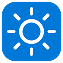
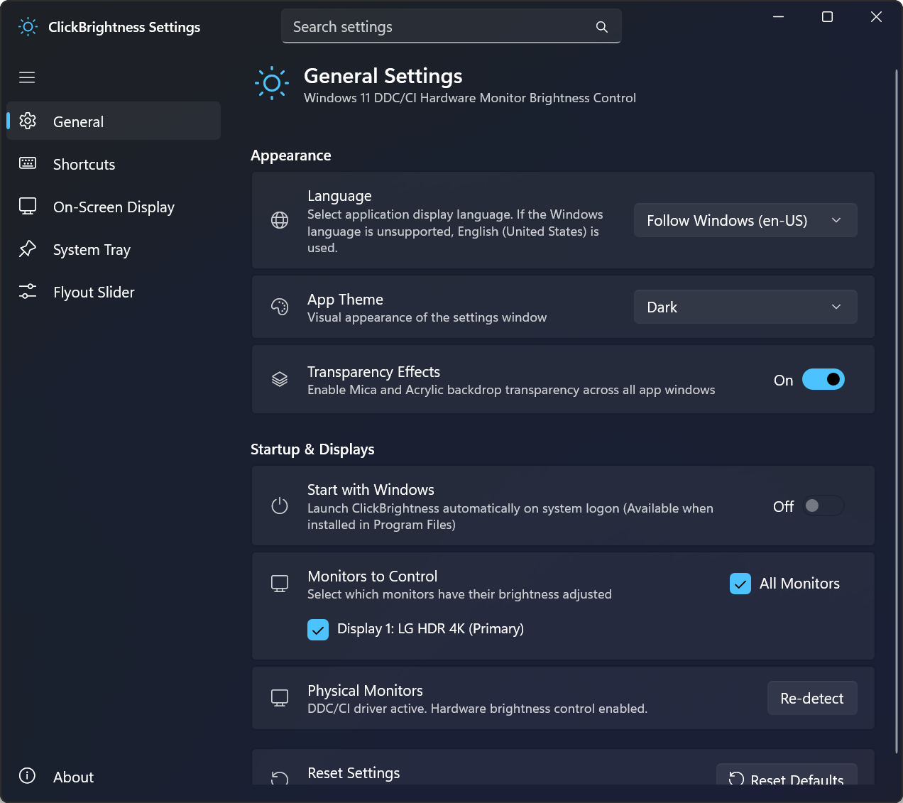
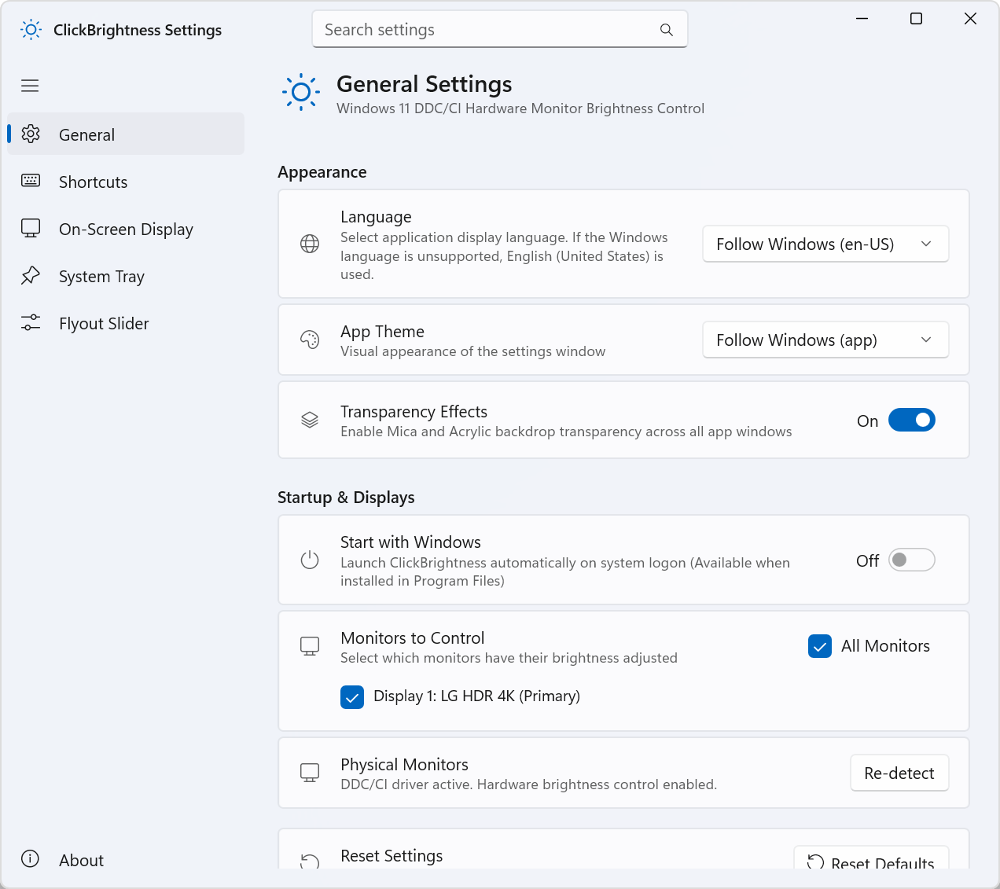
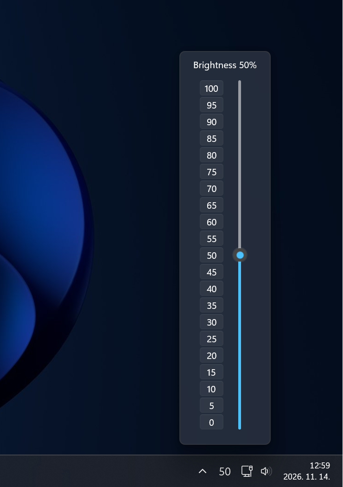
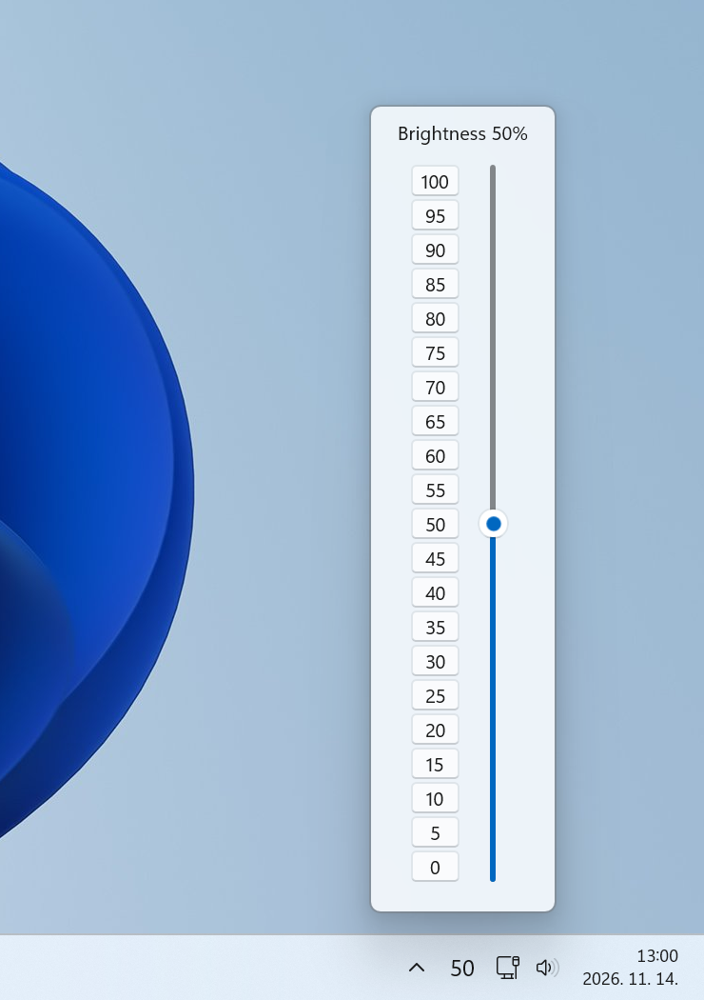
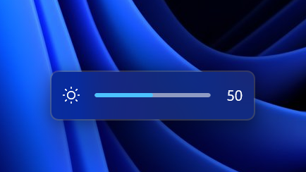
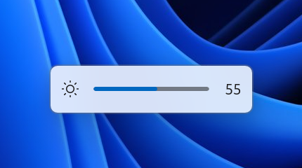

# ClickBrightness

<p align="center">
  <br/>
  <strong>Lightweight, modern Windows 11 DDC/CI monitor brightness utility</strong><br/><br/>
  
  
  
  
  
</p>

> **Note:** This is a vibecoded application (built and refined with AI assistance).

<p align="center">
  <a href="#screenshots">Screenshots</a> •
  <a href="#features">Features</a> •
  <a href="#installation">Installation</a> •
  <a href="#keyboard-shortcuts">Shortcuts</a> •
  <a href="#building-from-source">Building</a> •
  <a href="#translations">Translations</a> •
  <a href="#license">License</a>
</p>

---

## Overview

**ClickBrightness** is a native Windows 11 utility designed to effortlessly control the hardware brightness of external monitors using the VESA **DDC/CI** (Display Data Channel / Command Interface) protocol.

Unlike traditional software dimmers that merely draw a semi-transparent dark overlay on your screen, ClickBrightness communicates directly with your monitor's internal hardware controller over I2C, adjusting the actual backlight level for genuine power savings, reduced eye strain, and preserved color accuracy and contrast.

Built with **C++/WinRT** and **WinUI 3** (Windows App SDK), ClickBrightness features a modern Windows 11 Fluent interface with Mica backdrops, native Dark/Light themes, smooth animations, and system accent color integration.

---

## Screenshots

### Settings Window
*Full configuration with real-time preview, Mica backdrop, monitor detection, hotkey assignment, and tray percentage customizer.*

| Dark Mode | Light Mode |
| :---: | :---: |
|  |  |

### Quick Flyout Slider
*Hardware brightness slider with step buttons, quick preset shortcuts (0%, 25%, 50%, 75%, 100%), and mouse wheel stepping.*

| Dark Mode | Light Mode |
| :---: | :---: |
|  |  |

### On-Screen Display (OSD)
*Modern Windows 11 floating banner with smooth animations for real-time brightness adjustments.*

| Dark Mode | Light Mode |
| :---: | :---: |
|  |  |

---

## Features

### 🖥️ Real Hardware DDC/CI Backlight Control
- Communicates directly with external monitors via VESA DDC/CI.
- Supports **multi-monitor setups**: control all displays simultaneously or pick individual monitors.
- High-performance asynchronous background communication with debouncing to prevent monitor controller overload.
- Brightness caching ensures responsive slider movement even on slow-to-respond displays.

### 🔔 Modern Windows 11 Fluent UI
- **WinUI 3 Interface**: Native Windows 11 controls, typography, and layout.
- **Mica & Acrylic Backdrops**: Sleek transparency effects that seamlessly blend into the Windows desktop (can be toggled on/off).
- **Dark & Light Modes**: Supports *Follow Windows*, *Always Dark*, and *Always Light*, with dynamic real-time DWM caption and border synchronization.
- **Accent Color Customization**: Use your Windows system accent color or define custom accent colors with the built-in color picker.

### 📌 Smart System Tray Integration
- **Dynamic Brightness Indicator**: Shows current brightness percentage directly on the tray icon in real time.
- **Customizable Font & Placement**: Adjust font family, font size (1-2 digits and 100%), and vertical pixel offset (DPI-scaled).
- **Mouse Wheel Adjustment**: Scroll your mouse wheel directly over the tray icon to increase or decrease brightness with custom step increments.
- **Middle-Click Quick Action**: Middle-click the tray icon to instantly jump to a predefined brightness level (e.g. 50%).

### 🎚️ Quick Flyout Slider
- Left-click the tray icon to open a sleek quick flyout.
- High-precision slider with step buttons and quick preset buttons (0%, 25%, 50%, 75%, 100%).
- Full mouse wheel support over the flyout card.

### 🌟 Windows 11 On-Screen Display (OSD)
- Beautiful floating OSD banner with smooth fade-in / fade-out animations.
- Displays the current brightness level with a dynamic sun glyph.
- Configurable display timeout.
- Can be toggled on or off independently for hotkeys, mouse wheel scrolling, and middle-click actions.

### ⌨️ Global Hotkeys & Presets
- **Brightness Stepping**: Increase / decrease brightness from anywhere (defaults: `F14` / `F13`).
- **Brightness Presets**: Instant shortcuts for dedicated levels (defaults: `F15` @ 30%, `F16` @ 80%).
- **Interactive Key Capture**: Assign any key combination with `Ctrl`, `Alt`, `Shift`, and `Win` modifiers.
- **Continuous Hold / Repeat Rate**: Configurable repeat delay and interval for rapid adjustments without stutter.

### 🌍 Multi-Language Support
- Built-in **English** (`en-US`) and **Hungarian** (`hu-HU`).
- Dynamic JSON-based localization engine: drop a new `.json` file into the `lang/` folder to instantly add a new language without recompiling.

### 🚀 Self-Contained & Lightweight
- **Zero Runtime Dependencies**: Includes self-contained Windows App SDK and app-local C++ CRT runtime DLLs. No need to install separate redistributable packages.
- **Single-Instance Protection**: Opening the app when already running brings the existing instance to the foreground or opens Settings.
- **Auto-Start with Windows**: Toggle automatic startup directly in the settings.

---

## Architecture & Requirements

- **Operating System**: Windows 11 (build 22000 or newer) / Windows 10 (version 1809+, build 17763 or newer)
- **Supported Architectures**:
  - **x64** (Intel & AMD 64-bit)
  - **ARM64** (Snapdragon X Elite, Surface Pro, ThinkPad ARM, etc.)
- **Hardware Requirement**: A monitor connected via DisplayPort, HDMI, USB-C, or DVI with DDC/CI enabled in its on-screen menu (OSD).

---

## Installation

### Option 1: Windows Installer (MSI)
Download the latest installer matching your CPU architecture from the releases:
- **x64**: `ClickBrightness-1.0.6-x64.msi`
- **ARM64**: `ClickBrightness-1.0.6-arm64.msi`

The installer includes:
- Per-machine installation in `Program Files\ClickBrightness`.
- Start Menu shortcut.
- Optional Desktop shortcut checkbox.
- Clean upgrade and uninstallation via Windows Settings / Control Panel.

### Option 2: Portable / Standalone
1. Download or compile `ClickBrightness.exe` and its associated runtime files.
2. Place the executable and the `lang/` directory into any folder of your choice.
3. Run `ClickBrightness.exe`. Settings will be saved automatically to `settings.ini` in the application folder.

---

## Keyboard Shortcuts & Quick Controls

| Action | Default Shortcut / Gesture | Description |
| :--- | :--- | :--- |
| **Increase Brightness** | `F14` | Increases brightness by configurable step (default: +5%). |
| **Decrease Brightness** | `F13` | Decreases brightness by configurable step (default: -5%). |
| **Preset 1 (Dim)** | `F15` | Instantly sets brightness to Preset 1 (default: 30%). |
| **Preset 2 (Bright)** | `F16` | Instantly sets brightness to Preset 2 (default: 80%). |
| **Preset Toggle** | `F17` | Toggles between Preset 1 and Preset 2 brightness levels. |
| **Tray Scroll** | `Mouse Wheel` over Tray Icon | Increases/decreases brightness directly from the taskbar. |
| **Tray Middle-Click** | `Middle-Click` on Tray Icon | Instantly jumps to the middle-click target level (default: 50%). |
| **Open Quick Flyout** | `Left-Click` on Tray Icon | Opens the Windows 11 brightness slider flyout. |
| **Open Settings** | `Right-Click` Tray Icon → *Settings* | Opens the full configuration window. |

*(All hotkeys and gestures can be remapped or toggled on/off in the Settings window.)*

---

## 💻 Command-Line Interface (CLI)

ClickBrightness features a fast, low-overhead CLI with single-instance Inter-Process Communication (IPC). You can easily integrate ClickBrightness into scripts, batch files, Task Scheduler, Stream Deck keys, or terminal workflows:

- If ClickBrightness is **already running**, CLI commands signal the background instance instantly without launching duplicate processes.
- If ClickBrightness is **not running**, standalone commands (`--get`, `--monitors`, `--help`) execute and exit cleanly without starting a background service, while adjustment commands launch the service directly into the system tray.

### Command Reference

| Command | Short Flag | Description |
| :--- | :--- | :--- |
| `--set <0-100>` | `-b <0-100>`, `--brightness <0-100>` | Set hardware brightness to an exact percentage (e.g. `--set 65`). |
| `--up [step]` | — | Increase brightness by `step`% (or configured step if omitted). |
| `--down [step]` | — | Decrease brightness by `step`% (or configured step if omitted). |
| `--toggle` | `-t` | Toggle between Preset 1 and Preset 2 brightness levels. |
| `--preset <1\|2>` | `-p <1\|2>`, `--preset1`, `--preset2` | Jump directly to Preset 1 or Preset 2 brightness level. |
| `--get` | `-g` | Query and print current monitor brightness percentage to the console. |
| `--monitors` | `-m` | List all detected DDC/CI physical displays, friendly names, and ranges. |
| `--flyout` | `-f` | Open the Windows 11 brightness slider flyout popup near the tray. |
| `--settings` | `-s` | Open or bring the Settings window to the front. |
| `--exit` | `-e` | Cleanly terminate the running background application. |
| `--help` | `-h`, `/?` | Display command-line usage and examples. |

### Options & Modifiers

| Option | Description |
| :--- | :--- |
| `--osd` | Display the on-screen brightness banner during adjustment (default). |
| `--no-osd` | Suppress the on-screen display banner (silent hardware adjustment). |

### CLI Examples

```cmd
:: Set brightness to 75%
ClickBrightness.exe --set 75

:: Silent brightness change without showing the OSD overlay
ClickBrightness.exe --set 30 --no-osd

:: Increase brightness by 10%
ClickBrightness.exe --up 10

:: Toggle between configured day/night presets
ClickBrightness.exe --toggle

:: Query current brightness
ClickBrightness.exe --get

:: List all connected DDC/CI displays
ClickBrightness.exe --monitors

:: Open flyout slider
ClickBrightness.exe --flyout
```

---

## Building from Source

### Prerequisites
1. **Visual Studio 2022** (v17.4 or newer, Community / Professional / Enterprise)
   - Workload: **Desktop development with C++**
   - Individual Components:
     - *C++ (v143 or v145) Universal Windows Platform tools*
     - *MSVC v143/v145 - VS 2022 C++ ARM64 build tools* (if building ARM64)
     - *Windows 10/11 SDK* (10.0.26100.0 or 10.0.22621.0)
2. **WiX Toolset v5** (only required if building `.msi` installers):
   ```cmd
   dotnet tool install --global wix --version 5.0.2
   wix extension add WixToolset.UI.wixext/5.0.2
   wix extension add WixToolset.Util.wixext/5.0.2
   ```

### Building

#### Method 1: Visual Studio (Recommended)
1. Open `ClickBrightness.sln` in Visual Studio 2022.
2. Select your desired Configuration (`Release`) and Platform (`x64` or `ARM64`).
3. Press `Ctrl + Shift + B` (or **Build** → **Build Solution**).

#### Method 2: Batch Scripts (Quick & Self-Contained)
You can directly run or double-click the included batch scripts in Explorer or terminal:

| Target | Architecture | Binary Build | Installer (MSI) | Portable ZIP |
| :--- | :--- | :--- | :--- | :--- |
| **x64** | Intel / AMD 64-bit | `build.bat` | `build-installer.bat` | `build-portable.bat` |
| **ARM64** | Snapdragon X, Surface ARM | `build-arm64.bat` | `build-installer-arm64.bat` | `build-portable-arm64.bat` |

*Options:*
- Pass `-c` or `--clean` to `build.bat` / `build-arm64.bat` for a clean rebuild.
- Pass `--no-pause` to avoid the confirmation pause when running from scripts/CI.

#### Method 3: MSBuild Command Line
Open a Developer Command Prompt or PowerShell in the repository root:

```cmd
:: Build x64 Release
msbuild ClickBrightness.sln /p:Configuration=Release /p:Platform=x64 /m

:: Build ARM64 Release
msbuild ClickBrightness.sln /p:Configuration=Release /p:Platform=ARM64 /m
```

Binaries will be placed in `bin\<Platform>\Release\`.

---

## Translations

ClickBrightness features a flexible JSON translation framework. To add your own language:

1. Navigate to the `lang/` folder.
2. Duplicate `en-US.json` and name it with your locale code (e.g. `de-DE.json`, `fr-FR.json`, `es-ES.json`).
3. Set the metadata fields in the JSON file:
   ```json
   {
     "__language_code": "de-DE",
     "__language_name": "Deutsch",
     ...
   }
   ```
4. Translate the strings. Any missing keys automatically fall back to English.
5. Save the file. ClickBrightness will automatically detect and show your language in the Settings menu!

---

## License

This project is licensed under the [MIT License](LICENSE).
