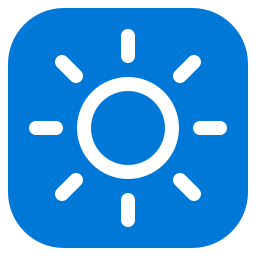

# ClickBrightness

<p align="center">
  
</p>

<p align="center">
  <strong>Lightweight, modern Windows 11 DDC/CI monitor brightness utility</strong>
</p>

<p align="center">
  <a href="#features">Features</a> •
  <a href="#installation">Installation</a> •
  <a href="#keyboard-shortcuts">Shortcuts</a> •
  <a href="#building-from-source">Building</a> •
  <a href="#translations">Translations</a> •
  <a href="#license">License</a>
</p>

---

## Overview

**ClickBrightness** is a native Windows 11 utility designed to effortlessly control the hardware brightness of external monitors using the VESA **DDC/CI** (Display Data Channel / Command Interface) protocol.

Unlike traditional software dimmers that merely draw a semi-transparent dark overlay on your screen, ClickBrightness communicates directly with your monitor's internal hardware controller over I2C, adjusting the actual backlight level for genuine power savings, reduced eye strain, and preserved color accuracy and contrast.

Built with **C++/WinRT** and **WinUI 3** (Windows App SDK), ClickBrightness features a modern Windows 11 Fluent interface with Mica backdrops, native Dark/Light themes, smooth animations, and system accent color integration.

---

## Features

### 🖥️ Real Hardware DDC/CI Backlight Control
- Communicates directly with external monitors via VESA DDC/CI.
- Supports **multi-monitor setups**: control all displays simultaneously or pick individual monitors.
- High-performance asynchronous background communication with debouncing to prevent monitor controller overload.
- Brightness caching ensures responsive slider movement even on slow-to-respond displays.

### 🔔 Modern Windows 11 Fluent UI
- **WinUI 3 Interface**: Native Windows 11 controls, typography, and layout.
- **Mica & Acrylic Backdrops**: Sleek transparency effects that seamlessly blend into the Windows desktop (can be toggled on/off).
- **Dark & Light Modes**: Supports *Follow Windows*, *Always Dark*, and *Always Light*, with dynamic real-time DWM caption and border synchronization.
- **Accent Color Customization**: Use your Windows system accent color or define custom accent colors with the built-in color picker.

### 📌 Smart System Tray Integration
- **Dynamic Brightness Indicator**: Shows current brightness percentage directly on the tray icon in real time.
- **Customizable Font & Placement**: Adjust font family, font size (1-2 digits and 100%), and vertical pixel offset (DPI-scaled).
- **Mouse Wheel Adjustment**: Scroll your mouse wheel directly over the tray icon to increase or decrease brightness with custom step increments.
- **Middle-Click Quick Action**: Middle-click the tray icon to instantly jump to a predefined brightness level (e.g. 50%).

### 🎚️ Quick Flyout Slider
- Left-click the tray icon to open a sleek quick flyout.
- High-precision slider with step buttons and quick preset buttons (0%, 25%, 50%, 75%, 100%).
- Full mouse wheel support over the flyout card.

### 🌟 Windows 11 On-Screen Display (OSD)
- Beautiful floating OSD banner with smooth fade-in / fade-out animations.
- Displays the current brightness level with a dynamic sun glyph.
- Configurable display timeout.
- Can be toggled on or off independently for hotkeys, mouse wheel scrolling, and middle-click actions.

### ⌨️ Global Hotkeys & Presets
- **Brightness Stepping**: Increase / decrease brightness from anywhere (defaults: `F14` / `F13`).
- **Brightness Presets**: Instant shortcuts for dedicated levels (defaults: `F15` @ 30%, `F16` @ 80%).
- **Interactive Key Capture**: Assign any key combination with `Ctrl`, `Alt`, `Shift`, and `Win` modifiers.
- **Continuous Hold / Repeat Rate**: Configurable repeat delay and interval for rapid adjustments without stutter.

### 🌍 Multi-Language Support
- Built-in **English** (`en-US`) and **Hungarian** (`hu-HU`).
- Dynamic JSON-based localization engine: drop a new `.json` file into the `lang/` folder to instantly add a new language without recompiling.

### 🚀 Self-Contained & Lightweight
- **Zero Runtime Dependencies**: Includes self-contained Windows App SDK and app-local C++ CRT runtime DLLs. No need to install separate redistributable packages.
- **Single-Instance Protection**: Opening the app when already running brings the existing instance to the foreground or opens Settings.
- **Auto-Start with Windows**: Toggle automatic startup directly in the settings.

---

## Architecture & Requirements

- **Operating System**: Windows 11 (build 22000 or newer) / Windows 10 (version 1809+, build 17763 or newer)
- **Supported Architectures**:
  - **x64** (Intel & AMD 64-bit)
  - **ARM64** (Snapdragon X Elite, Surface Pro, ThinkPad ARM, etc.)
- **Hardware Requirement**: A monitor connected via DisplayPort, HDMI, USB-C, or DVI with DDC/CI enabled in its on-screen menu (OSD).

---

## Installation

### Option 1: Windows Installer (MSI)
Download the latest installer matching your CPU architecture from the releases:
- **x64**: `ClickBrightness-1.0.0-x64.msi`
- **ARM64**: `ClickBrightness-1.0.0-arm64.msi`

The installer includes:
- Per-machine installation in `Program Files\ClickBrightness`.
- Start Menu shortcut.
- Optional Desktop shortcut checkbox.
- Clean upgrade and uninstallation via Windows Settings / Control Panel.

### Option 2: Portable / Standalone
1. Download or compile `ClickBrightness.exe` and its associated runtime files.
2. Place the executable and the `lang/` directory into any folder of your choice.
3. Run `ClickBrightness.exe`. Settings will be saved automatically to `ClickBrightness.ini` in the application folder.

---

## Keyboard Shortcuts & Quick Controls

| Action | Default Shortcut / Gesture | Description |
| :--- | :--- | :--- |
| **Increase Brightness** | `F14` | Increases brightness by configurable step (default: +5%). |
| **Decrease Brightness** | `F13` | Decreases brightness by configurable step (default: -5%). |
| **Preset 1 (Dim)** | `F15` | Instantly sets brightness to Preset 1 (default: 30%). |
| **Preset 2 (Bright)** | `F16` | Instantly sets brightness to Preset 2 (default: 80%). |
| **Tray Scroll** | `Mouse Wheel` over Tray Icon | Increases/decreases brightness directly from the taskbar. |
| **Tray Middle-Click** | `Middle-Click` on Tray Icon | Instantly jumps to the middle-click target level (default: 50%). |
| **Open Quick Flyout** | `Left-Click` on Tray Icon | Opens the Windows 11 brightness slider flyout. |
| **Open Settings** | `Right-Click` Tray Icon → *Settings* | Opens the full configuration window. |

*(All hotkeys and gestures can be remapped or toggled on/off in the Settings window.)*

---

## Building from Source

### Prerequisites
1. **Visual Studio 2022** (v17.4 or newer, Community / Professional / Enterprise)
   - Workload: **Desktop development with C++**
   - Individual Components:
     - *C++ (v143 or v145) Universal Windows Platform tools*
     - *MSVC v143/v145 - VS 2022 C++ ARM64 build tools* (if building ARM64)
     - *Windows 10/11 SDK* (10.0.26100.0 or 10.0.22621.0)
2. **WiX Toolset v5** (only required if building `.msi` installers):
   ```cmd
   dotnet tool install --global wix --version 5.0.2
   wix extension add WixToolset.UI.wixext/5.0.2
   wix extension add WixToolset.Util.wixext/5.0.2
   ```

### Build Commands

Open a Command Prompt or PowerShell in the repository root:

```cmd
:: Build x64 Release (Default)
build.bat Release x64 --no-pause

:: Build ARM64 Release
build.bat Release ARM64 --no-pause

:: Clean rebuild
build.bat Release x64 -c --no-pause

:: Build WiX MSI Installers (both x64 and ARM64)
build-installer.bat all --no-pause
```

Binaries will be placed in `bin\<Platform>\Release\`.

---

## Translations

ClickBrightness features a flexible JSON translation framework. To add your own language:

1. Navigate to the `lang/` folder.
2. Duplicate `en-US.json` and name it with your locale code (e.g. `de-DE.json`, `fr-FR.json`, `es-ES.json`).
3. Set the metadata fields in the JSON file:
   ```json
   {
     "__language_code": "de-DE",
     "__language_name": "Deutsch",
     ...
   }
   ```
4. Translate the strings. Any missing keys automatically fall back to English.
5. Save the file. ClickBrightness will automatically detect and show your language in the Settings menu!

---

## License

This project is licensed under the **MIT License**.

```
Copyright (c) 2026 andris155

Permission is hereby granted, free of charge, to any person obtaining a copy
of this software and associated documentation files (the "Software"), to deal
in the Software without restriction, including without limitation the rights
to use, copy, modify, merge, publish, distribute, sublicense, and/or sell
copies of the Software, and to permit persons to whom the Software is
furnished to do so, subject to the following conditions:

The above copyright notice and this permission notice shall be included in all
copies or substantial portions of the Software.

THE SOFTWARE IS PROVIDED "AS IS", WITHOUT WARRANTY OF ANY KIND, EXPRESS OR
IMPLIED, INCLUDING BUT NOT LIMITED TO THE WARRANTIES OF MERCHANTABILITY,
FITNESS FOR A PARTICULAR PURPOSE AND NONINFRINGEMENT. IN NO EVENT SHALL THE
AUTHORS OR COPYRIGHT HOLDERS BE LIABLE FOR ANY CLAIM, DAMAGES OR OTHER
LIABILITY, WHETHER IN AN ACTION OF CONTRACT, TORT OR OTHERWISE, ARISING FROM,
OUT OF OR IN CONNECTION WITH THE SOFTWARE OR THE USE OR OTHER DEALINGS IN THE
SOFTWARE.
```
